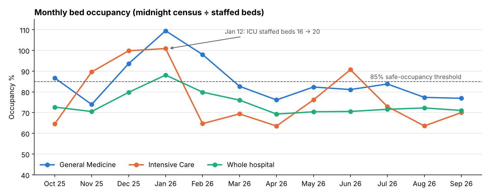
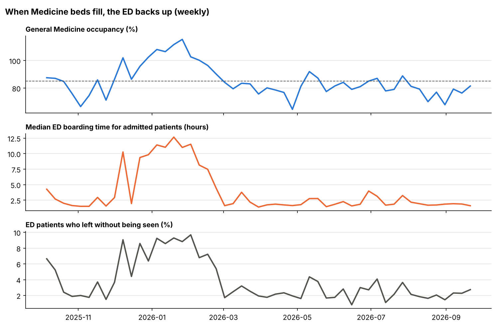
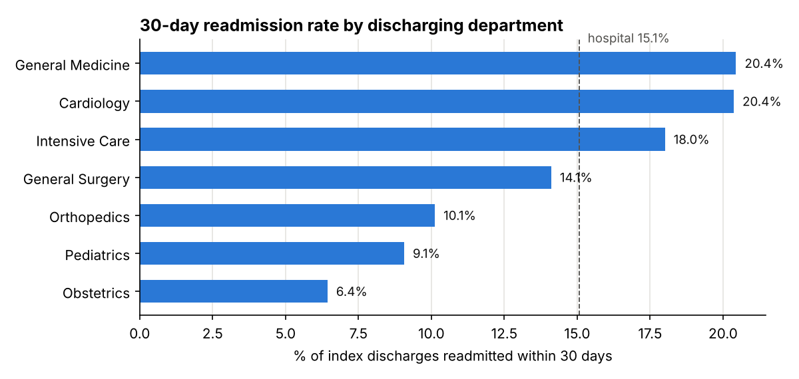

# Hospital Operations KPI Dashboard (SQL + Power BI)

An operations reporting layer for a 194-bed hospital (198 after an ICU expansion): a **star schema in SQL**, **reporting views** that define each KPI once, **DAX measures**, and a step-by-step Power BI build. It tracks bed occupancy, length of stay, 30-day readmissions and emergency department throughput across FY2026 (Oct 2025 – Sep 2026).



## What the data shows

**1. The winter surge pushed General Medicine past capacity.** Medicine averaged 109% occupancy in January, meaning patients were in overflow beds, and ICU hit 101%. The hospital added 4 ICU staffed beds on January 12, and ICU occupancy fell to 65% in February. Medicine got no extra capacity and stayed at 98%.

**2. Full wards back up the Emergency Department.** Admitted patients wait in the ED until a ward bed is free (boarding). Across the year:

| Medicine occupancy (weekly) | Weeks | Median ED boarding | Left without being seen |
|---|---|---|---|
| under 85% | 31 | 1.7–1.8 hrs | ~2% |
| 85–95% | 12 | 2.9–4.4 hrs | 4–6% |
| 95% and above | 10 | 8.4–11.0 hrs | ~8% |



Boarders take up ED beds and staff, so new arrivals wait longer to see a provider (median 92 minutes in January, against about 36 in summer), and more of them leave. The operational lesson is that ED crowding was a **Medicine bed-capacity problem, not an ED staffing problem**. The ICU expansion shows that adding beds where the bottleneck is works.

> The data is synthetic and this mechanism is built into the simulation (see `data/generate.py`), so the dashboard is demonstrating that it can surface the pattern, not discovering it. The pattern itself (boarding and LWBS rising as inpatient occupancy passes ~85%) is well documented in real hospitals.

**3. Readmissions concentrate in Medicine and Cardiology** (20.4% each, against 15.1% hospital-wide), the usual targets for discharge-planning and follow-up-call programmes.



## FY2026 scorecard

| Occupancy | ALOS | 30-day readmission | ED visits | Median door-to-provider | LWBS | Median boarding |
|---|---|---|---|---|---|---|
| 74.3% | 4.08 days | 15.1% | 49,629 | 42.8 min | 4.0% | 2.7 hrs |

Full monthly and departmental values are in [`reports/reference_kpis.md`](reports/reference_kpis.md). These are the numbers the Power BI report must reproduce.

## Data model

```
                      ┌──────────────┐
                      │   dim_date   │  fiscal year starts Oct
                      └──────┬───────┘
          ┌──────────────────┼────────────────────┐
┌─────────┴─────────┐ ┌──────┴───────────────┐ ┌──┴────────────┐
│ fact_bed_capacity │ │ fact_inpatient_      │ │ fact_ed_visit │
│ dept × day        │ │ encounter (per stay) │ │ (per visit)   │
└─────────┬─────────┘ └──┬────────┬──────┬───┘ └──┬────────────┘
          │              │        │      │        │
   ┌──────┴─────────┐    │  ┌─────┴───┐  └──┬─────┘
   │ dim_department ├────┘  │dim_payer│ ┌───┴─────────┐
   └────────────────┘       └─────────┘ │ dim_patient │
                                        └─────────────┘
```

Primary keys, foreign keys and check constraints are enforced on load ([`sql/01_schema.sql`](sql/01_schema.sql)). The reporting views ([`sql/03_views.sql`](sql/03_views.sql)) hold the KPI logic:

| View | Grain | Key logic |
|---|---|---|
| `vw_daily_census` | department × day | Midnight census via a range join of stays to calendar days; occupancy = census ÷ staffed beds |
| `vw_inpatient_stay` | stay | LOS in midnights (min 1); `LEAD()` over each patient's admissions finds the next stay; CMS-style **index discharge** excludes deaths, transfers, AMA, and discharges without 30 days of follow-up |
| `vw_ed_visit` | ED visit | Door-to-provider, ED length of stay and boarding minutes; LWBS and admitted flags |
| `vw_monthly_hospital_kpi` | month | The scorecard: ratio-of-sums occupancy, ALOS, readmission rate, ED medians (`percentile_cont`) |

### Definitions that matter

- **Occupancy is a ratio of sums** (patient days ÷ bed days), not an average of daily percentages. Otherwise a 16-bed ICU would count as much as a 64-bed Medicine unit.
- **Readmission rates need a complete follow-up window.** September 2026 discharges can't be scored yet. Including them would make September look artificially good, and the view excludes them automatically.
- **Opening census.** Patients admitted in Aug–Sep 2025 who were still in a bed on Oct 1 are kept so October occupancy isn't understated. They are excluded from admission counts.

## Power BI

[`powerbi/measures.dax`](powerbi/measures.dax) has 29 measures in display folders (Capacity, Inpatient flow, Readmissions, Emergency Department). Examples:

```dax
Admissions =
CALCULATE ( COUNTROWS ( 'Inpatient Stays' ),
            USERELATIONSHIP ( 'Inpatient Stays'[admit_date_key], 'Date'[date_key] ) )

Readmission Rate 30d (Rolling 3M) =
CALCULATE ( [Readmission Rate 30d],
            DATESINPERIOD ( 'Date'[calendar_date], MAX ( 'Date'[calendar_date] ), -3, MONTH ) )

Occupancy Color =
SWITCH ( TRUE (), ISBLANK ( [Occupancy %] ), BLANK (),
         [Occupancy %] >= 0.95, "#C0392B", [Occupancy %] >= 0.85, "#E6A100", "#1E8449" )
```

[`powerbi/BUILD_GUIDE.md`](powerbi/BUILD_GUIDE.md) walks through the four-page report (Executive overview, Capacity, Emergency Department, Readmissions): loading, types, relationships (including the inactive admit-date relationship), measures, every visual, and a troubleshooting table for when a number doesn't match the reference values.

## Run it

```bash
pip install -r requirements.txt
python data/generate.py   # synthetic source tables → data/csv/
python build.py           # schema + views in DuckDB → data/powerbi/*.csv, reports/reference_kpis.md, images/
pytest                    # 6 tests: every view re-derived independently in pandas
```

PostgreSQL:

```bash
createdb hospital_ops
psql -d hospital_ops -f sql/01_schema.sql -f sql/02_load_postgres.sql -f sql/03_views.sql
```

## Data

All data is **synthetic** (seeded and reproducible): 13,228 inpatient stays, 49,629 ED visits, 26,000 patients and 7 departments. No real patient information is used.

## Project structure

```
├── sql/
│   ├── 01_schema.sql          star schema with PK/FK/check constraints
│   ├── 02_load_postgres.sql   psql \copy loader
│   └── 03_views.sql           census, stay, ED and monthly KPI views
├── powerbi/
│   ├── measures.dax           all DAX measures
│   └── BUILD_GUIDE.md         step-by-step report build + validation
├── data/
│   ├── generate.py            hospital operations simulator
│   ├── csv/                   source tables
│   └── powerbi/               model-ready tables for Power BI
├── build.py                   DuckDB build, exports, reference values, charts
├── reports/reference_kpis.md  the numbers Power BI must match
└── tests/test_views.py
```

## Tools

SQL (PostgreSQL / DuckDB) · Power BI · DAX · Python · pandas · matplotlib · pytest
